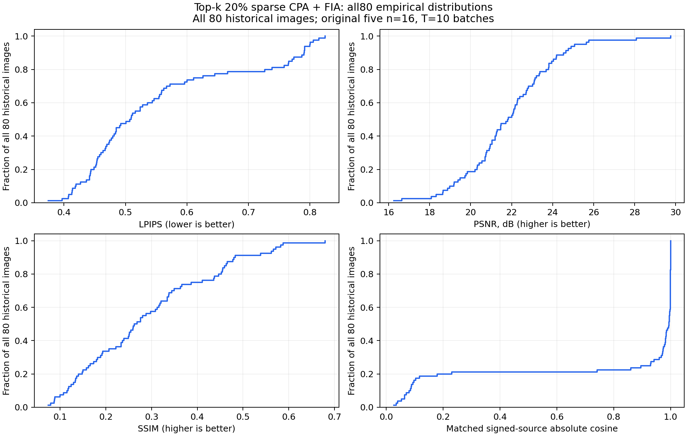

# Top-k 20% sparse CPA + FIA: original historical80

All 80 historical images; original five n=16, T=10 batches.

This run reuses the exact 80 historical M6/M8 images, in their original order and five 16-image batches. Each batch uses its cached actual (W_initial - W_after10)/lr update from the pretrained VGG16 round-0 classifier. The five independent client updates were already collected; this run does not retrain or regroup the clients. No historical LPIPS scores are used to select images.

| Method | Images | LPIPS | PSNR (dB) | SSIM | Source absolute cosine > 0.9 |
|---|---:|---:|---:|---:|---:|
| Top-k 20% sparse + upstream CPA + FIA | 80 | 0.553605 | 21.872 | 0.2906 | 60/80 |

The attacker receives only the zero-filled observation decoded from each real sparse binary packet. Global magnitude Top-k within the attacked FC1 tensor retains floor(N * 20 / 100) of N coordinates, breaking cutoff ties by ascending flat index. Selected values remain bit-exact FP32 and are serialized with a row-major bitmap. There is no quantization, rescaling, error feedback or missing-value estimation. All 16 CPA source estimates pass through abs(S_hat) into the original Direct FIA for each batch. Signed-source absolute-cosine Hungarian matching is applied only after FIA for evaluation, without truth scaling or source replacement.

The five attacked first-FC weight packets total **475,267,220 bytes**: 411,041,780 FP32 value bytes, 64,225,280 position bitmap bytes and 160 header bytes. The computed same-shape FP32 packets total 2,055,209,120 bytes, giving **4.3243x** compression and **76.8750%** fewer packet bytes.
The FP32 byte count is a serialization calculation, not an FP32 attack result. Compression covers classifier.0.weight only. The same80 packed 4-bit run uses the same source updates, CPA/FIA implementation, seeds and matching order; only compression is changed. Historical 32-bit results use a different CPA implementation and cannot isolate compression alone. This condition does not measure full-model traffic, network latency or multi-round training utility.

| Original batch | Images | LPIPS | PSNR (dB) | SSIM | Source cosine > 0.9 | Packet bytes |
|---|---:|---:|---:|---:|---:|---:|
| 0 | 16 | 0.540996 | 21.491 | 0.3093 | 13/16 | 95,053,444 |
| 1 | 16 | 0.564765 | 21.170 | 0.2574 | 11/16 | 95,053,444 |
| 2 | 16 | 0.533176 | 23.057 | 0.3357 | 13/16 | 95,053,444 |
| 3 | 16 | 0.549860 | 22.010 | 0.3103 | 12/16 | 95,053,444 |
| 4 | 16 | 0.579227 | 21.632 | 0.2403 | 11/16 | 95,053,444 |

CPA iterations per batch: 25,000; FIA iterations per batch: 25,000. Summed batch runtimes in seconds: codec=31.4, cpa=198.1, fia=9607.2, invocation=9819.9, update_collection=0.0.
All80 images are evaluated. Per-source cosine is logged individually; the >0.9 count is an embedding diagnostic, not an image-success threshold. Image metrics remain directly measured values without historical control normalization.

[Original batch 0: all16 originals and reconstructions](batch00_reconstruction_landscape.png)
[Original batch 1: all16 originals and reconstructions](batch01_reconstruction_landscape.png)
[Original batch 2: all16 originals and reconstructions](batch02_reconstruction_landscape.png)
[Original batch 3: all16 originals and reconstructions](batch03_reconstruction_landscape.png)
[Original batch 4: all16 originals and reconstructions](batch04_reconstruction_landscape.png)

Per-image measurements: `per_image_metrics.csv`; per-batch measurements: `per_batch_metrics.csv`; packet accounting per batch: `communication.csv`; codec diagnostics: `sparsification_diagnostics.csv`; distributions: `metric_distributions.csv`. `all80_rec.pt` retains all float reconstructions in original order; `figure_manifest.json` records native tile hashes.
