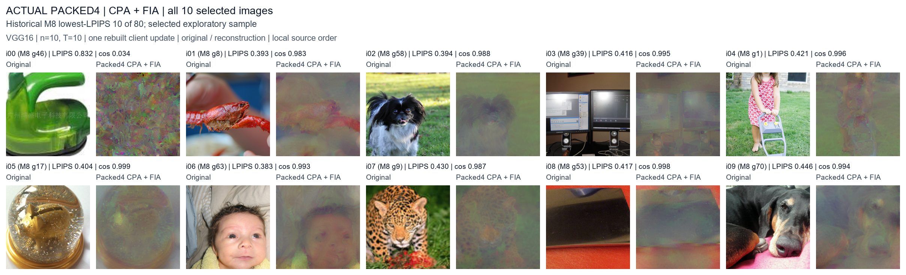
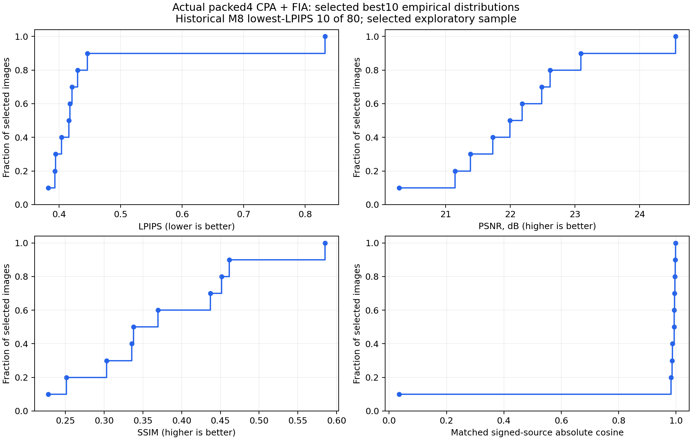

# Actual packed4 CPA + FIA: selected best10

Historical M8 lowest-LPIPS 10 of 80; selected exploratory sample.

The input data were selected using historical M8 LPIPS before this run. The ten cached image features formed one rebuilt n=10, T=10 client update from the pretrained VGG16 round-0 classifier. These measurements describe this selected exploratory sample; they do not estimate reconstruction quality over the original 80 images.

| Method | Images | LPIPS | PSNR (dB) | SSIM | Source absolute cosine > 0.9 |
|---|---:|---:|---:|---:|---:|
| Actual packed4 + upstream CPA + FIA | 10 | 0.453650 | 22.146 | 0.3760 | 9/10 |

The observation is decoded from the saved binary packet: per-row stochastic 16-level integer quantization, two four-bit codes per byte, and decoder-visible FP32 radii. The attacker receives the decoded packet observation. Source estimates pass through abs(S_hat) into the original Direct FIA; Hungarian absolute-cosine correspondence is applied after FIA for evaluation.

The attacked first-FC weight packet contains **51,396,640 bytes**: 51,380,224 code bytes, 16,384 radius bytes and 32 header bytes. The same-shape FP32 packet would contain 411,041,824 bytes (411,041,792 tensor-data bytes), giving **7.9974x** compression and **87.4960%** fewer packet bytes.
This byte comparison uses a computed same-shape FP32 serialization size; it is not an additional FP32 attack experiment. Byte savings cover classifier.0.weight only. Full-model traffic, networking latency and multi-round training utility were not measured.

CPA iterations: 25,000; FIA iterations: 25,000. Batch runtimes in seconds: codec=2.5, cpa=41.3, fia=1271.9, invocation=1316.4, update_collection=1.6.
All ten selected images are retained. Per-source cosine is reported individually; its >0.9 count is an embedding diagnostic, not an image-success threshold. LPIPS, PSNR and SSIM remain directly measured values without historical control normalization.

Per-image measurements: `per_image_metrics.csv`; per-batch measurements: `per_batch_metrics.csv`; measured packet accounting: `communication.csv`; codec error diagnostics: `quantization_diagnostics.csv`; distribution statistics: `metric_distributions.csv`.
