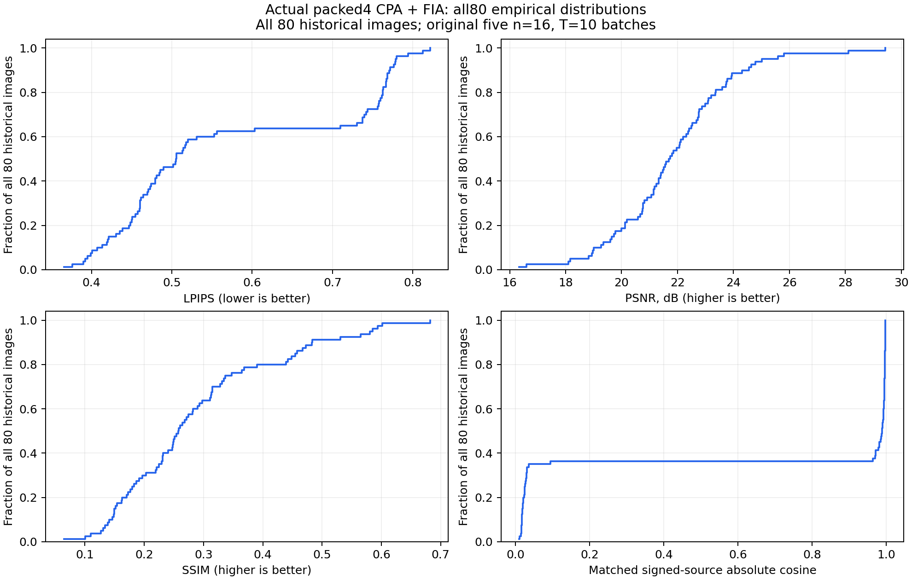

# Actual packed4 CPA + FIA: original historical80

All 80 historical images; original five n=16, T=10 batches.

This run reuses the exact 80 historical M6/M8 images, in their original order and five 16-image batches. Each batch uses its cached actual (W_initial - W_after10)/lr update from the pretrained VGG16 round-0 classifier. The five independent client updates were already collected; this run does not retrain or regroup the clients. No historical LPIPS scores are used to select images.

| Method | Images | LPIPS | PSNR (dB) | SSIM | Source absolute cosine > 0.9 |
|---|---:|---:|---:|---:|---:|
| Actual packed4 + upstream CPA + FIA | 80 | 0.573202 | 21.831 | 0.2889 | 51/80 |

The attacker receives the observation decoded from each real packed4 binary packet: per-row stochastic 16-level integer quantization, two four-bit codes per byte, and decoder-visible FP32 radii. All 16 CPA source estimates pass through abs(S_hat) into the original Direct FIA for each batch. Signed-source absolute-cosine Hungarian matching is applied only after FIA for evaluation, without truth scaling or source replacement.

The five attacked first-FC weight packets total **256,983,200 bytes**: 256,901,120 code bytes, 81,920 radius bytes and 160 header bytes. The computed same-shape FP32 packets total 2,055,209,120 bytes, giving **7.9974x** compression and **87.4960%** fewer packet bytes.
The FP32 byte count is a serialization calculation, not an FP32 attack result. Compression covers classifier.0.weight only. This condition does not measure an attack-quality difference against FP32, full-model traffic, network latency or multi-round training utility.

| Original batch | Images | LPIPS | PSNR (dB) | SSIM | Source cosine > 0.9 | Packet bytes |
|---|---:|---:|---:|---:|---:|---:|
| 0 | 16 | 0.566264 | 21.453 | 0.2939 | 11/16 | 51,396,640 |
| 1 | 16 | 0.594759 | 21.196 | 0.2600 | 9/16 | 51,396,640 |
| 2 | 16 | 0.543035 | 23.020 | 0.3308 | 12/16 | 51,396,640 |
| 3 | 16 | 0.566131 | 21.783 | 0.3139 | 10/16 | 51,396,640 |
| 4 | 16 | 0.595821 | 21.702 | 0.2461 | 9/16 | 51,396,640 |

CPA iterations per batch: 25,000; FIA iterations per batch: 25,000. Summed batch runtimes in seconds: codec=12.4, cpa=202.2, fia=9928.2, invocation=10148.3, update_collection=0.0.
All80 images are evaluated. Per-source cosine is logged individually; the >0.9 count is an embedding diagnostic, not an image-success threshold. Image metrics remain directly measured values without historical control normalization.

[Original batch 0: all16 originals and reconstructions](batch00_reconstruction_landscape.png)
[Original batch 1: all16 originals and reconstructions](batch01_reconstruction_landscape.png)
[Original batch 2: all16 originals and reconstructions](batch02_reconstruction_landscape.png)
[Original batch 3: all16 originals and reconstructions](batch03_reconstruction_landscape.png)
[Original batch 4: all16 originals and reconstructions](batch04_reconstruction_landscape.png)

Per-image measurements: `per_image_metrics.csv`; per-batch measurements: `per_batch_metrics.csv`; packet accounting per batch: `communication.csv`; codec diagnostics: `quantization_diagnostics.csv`; distributions: `metric_distributions.csv`. `all80_rec.pt` retains all float reconstructions in original order; `figure_manifest.json` records native tile hashes.
