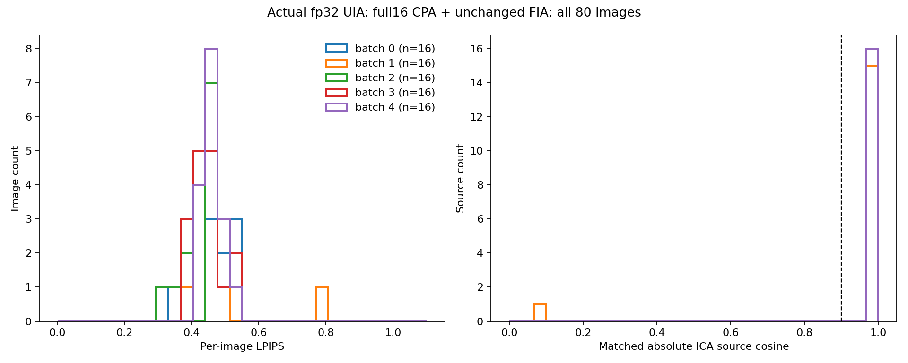
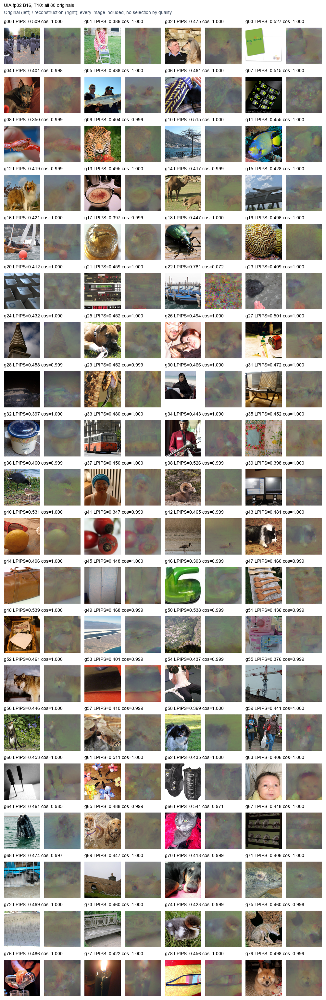

# M6 UIA fp32 B16 + CPA/FIA

Completed: 80 images, five independent B=16 client updates from round 0; T=10, SGD lr=0.001.

| Metric | Value |
|---|---:|
| Mean LPIPS | 0.45459726 |
| Mean PSNR | 22.4060 |
| Mean SSIM | 0.342655 |
| ICA sources with absolute cosine > 0.9 | 79/80 |

Published Table 5 n=16 reference LPIPS: **0.410**; observed mean minus reference: **+0.04459726**. This compares protocol-level results on different images, not paired reconstruction outcomes.

Fixed decision band: **protocol_difference_review**. identify protocol difference and footnote; keep FedAvg

CPA consumes the actual observed (W_initial - W_after)/lr. B_T @ Z is retained only to diagnose floating-point update error.
Full 16 CPA components, zero quantization delta, no MP truncation, no debiasing; missing sources/failed whitening abort. No oracle-source fills.
FIA uses the historical abs(source) adapter and permutation-only matching, 25,000 iterations, TV=0.1, FI=1, Adam lr=0.1, cosine schedule, seed 42, batches of 16.

The GIA reference 0.44481556 used B=8 and 40 different batch compositions, including four exact-source fills. It is an unpaired contextual reference, not a controlled UIA effect estimate.
The 80 fixed distinct-label validation images differ from the authors' shuffled sampling protocol; local n=16 fits inside nominal minibatch 32. The model is reset before each independent update.

No automatic 4-bit, Stage 2, refinement, or GMA task is launched.
