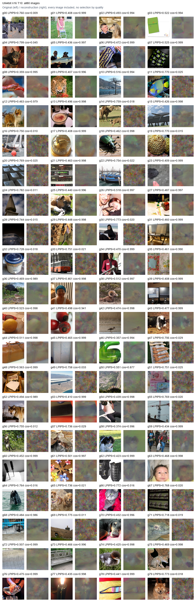
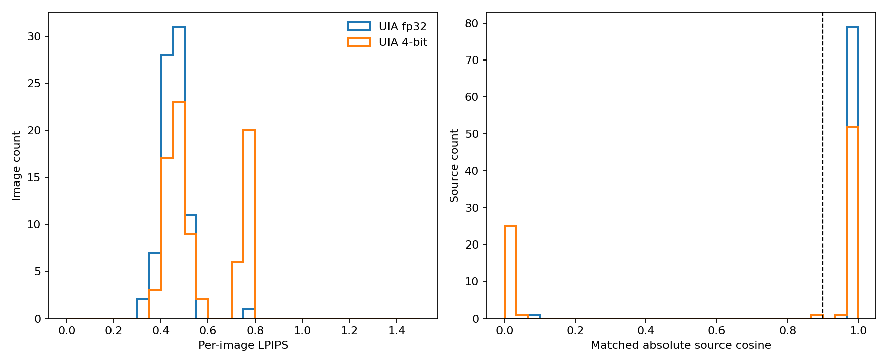

# M7 UIA4bit n16 T10

All80 original images and the exact five stored fp32 actual client updates were reused. No new training or update collection occurred.

| Condition | n / T | Images | LPIPS | PSNR | SSIM | Embedding cos>0.9 |
|---|---:|---:|---:|---:|---:|---:|
| UIA fp32 | 16 / 10 | 80 | 0.4546 | 22.406 | 0.3427 | 79/80 |
| UIA 4-bit | 16 / 10 | 80 | 0.5586 | 21.926 | 0.2976 | 53/80 |
| GIA 4-bit | 8 / 1 | 40 | 0.5439 | 21.536 | 0.3070 | 29/40 |

UIA rows are paired on the same80 originals and actual updates. GIA4bit is a historical40-image B8 gradient experiment; it is a cross-protocol reference.
Paired mean LPIPS increase (4-bit minus fp32): 0.10398628.
MP predicted B_eff: 55/80; measured matched |cosine|>0.9: 53/80.

The repository's stochastic quantizer is its subtractive-dither observation model Y+Uniform(-delta/2,delta/2), with per-row delta=2max(abs(Y))/15 and inward cell projection. It is not conventional integer stochastic rounding or a measured deployed integer codec. Quantization applies only to the saved actual Y_delta_over_lr; ideal B_T@Z is never an attack input.
The existing MP predictor debiases its diagnostic covariance and uses c_MP=3. CPA separately keeps full16 raw quantized axes with no debiasing or MP truncation. The diagnostic does not choose targets or alter the attack.
CPA and FIA each use25000 iterations, with all source adaptation, matching, budgets and FIA TV0.1/FI1/Adam0.1/cosine/seed42 held equal to UIAfp32. Matching permutes abs(S_hat) only. Every image is scored; no oracle fills, Stage2, refinement or new training.
UIAfp32 LPIPS0.4546 lies0.0066 above the upper end of the published CPA+FIA Table5 batch16–128 range0.410–0.448; this is a range-boundary comparison, not identical-protocol reproduction.

