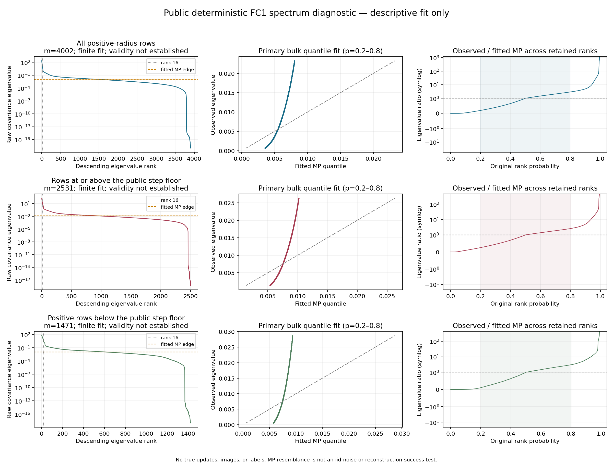

# 공개 deterministic FC1 스펙트럼 진단

등록된 공개 packet을 한 번 분석했다. **현재 제안한 MP 방향별 가중치가 균등 가중보다 큰 추가 효과를 낼 근거는 약하다.** 이는 아래 측정치와 가중치 공식에서 얻은 제한적인 해석이며, 복원 성능을 측정한 결과는 아니다.

## 측정 결과

| 공개 행 분할 | 행 수 m | MP 중앙 분위수 상대오차 RMS | 추정 MP 경계 | λ16 / 경계 | 경계 위 고유값 수 |
|---|---:|---:|---:|---:|---:|
| 양수 radius 전체 | 4,002 | 0.7740 | 0.01133757 | 1,169.73 | 1,415 |
| 공개 step floor 이상 | 2,531 | 0.6546 | 0.01351553 | 491.03 | 913 |
| 양수이며 floor 미만 | 1,471 | 0.8342 | 0.01168031 | 650.06 | 593 |

FC1 전체 4,096행 중 zero-radius는 94행이다. 이 행들은 정규화 스펙트럼에서만 분리했고 원래 packet이나 제약을 변경하지 않았다. floor는 전체 6개 공개 FC packet의 양수 행 간격에 대한 기존 lower median인 `4.0987196067969e-6`이다.

상대오차는 `|관측 고유값 / 적합 MP 분위수 − 1|`이며, 표의 RMS는 사전등록한 중앙 확률 구간 0.2–0.8에서 계산했다. 따라서 0.7740은 모델값 대비 상대오차 RMS 약77.4%를 뜻한다. `status=OK`는 유한한 적합값을 계산했다는 뜻이다. MP 모형 합격이나 정식 통계적 기각 판정이 아니다. 경계 위 고유값 수를 source 수·복원 가능한 이미지 수로 해석하지 않는다.

## MP 가중치 제안에 대한 의미

기존 후보 식은 `w_k=max(0, 1−edge/λ_k)`다. 상위16개에서는 `λ_k>=λ16`이므로 다음은 측정된 비율의 **수학적 귀결**이다. H를 구현하거나 복원에 적용해서 얻은 결과가 아니다.

- 전체 양수 행으로 만든 상위16개의 가중치는 모두 약 **0.999145 이상**이다.
- floor 이상 분할에서도 모두 약 **0.997963 이상**, 미만 분할에서는 약 **0.998462 이상**이다.
- 즉 이 식은 현재 상위16개 방향에 거의 균등한 가중치를 준다. 같은 부분공간과 epsilon을 쓰는 평균 가중 대조군에 비해 MP가 추가하는 방향별 차등은 작다.

정규직교 V와 같은 epsilon에 대해 `||H_MP−H_flat||₂ <= (1−epsilon)*edge/λ16`이다. 이것은 H의 차이에 대한 경계이며 최적화 경로나 최종 이미지 차이에 대한 보장은 아니다. 일반적인 부분공간 가중과 원래 FIA 사이의 효과도 이번에 측정하지 않았다.

## 적합 민감도와 특징 방향

각 분할에서 0.1–0.9 / 0.2–0.8 / 0.3–0.7 구간의 median 추정 scale과 edge는 같았지만, 잔차는 달랐다. 전체 양수 행의 RMS는 넓은/기본/좁은 구간에서 **1.2109 / 0.7740 / 0.4834**다. 중첩된 대칭 구간의 median이 같은 중앙값을 선택할 수 있으므로 동일 edge만으로 모형 적합성이 확인됐다고 판단하지 않는다.

상위16차원 특징 부분공간의 정규화 projector overlap은 전체 대 floor 이상 **0.9227**, 전체 대 floor 미만 **0.9697**, 두 분할 사이 **0.8756**이다. 전체 대 floor 이상 비교의 최대 principal angle은 **72.38°**다. 전체적인 중첩은 높지만 모든 방향이 동일하게 안정적인 것은 아니다. 개별 방향을 특정 이미지와 일대일로 대응시키지 않는다.

세 분할의 고유분해와 오른쪽 특이벡터 수치 검사는 모두 통과했다. 최대 직교성 오차는 약 `3.40e-14`이다. 원래 음수 고유값은 CSV/JSON에 보존했고 수치 허용오차 안의 작은 음수만 적합 과정에서0으로 처리했다.

## 실행 범위와 비용

- 합성·수치 검증 **59개 테스트 통과** 후 공개 packet 진단을 실행했다.
- CPU FP64, 8스레드. 본 진단 **9.0초**: packet 검증/읽기, Gram 계산, 분할별 고유분해, 적합, NPZ/CSV 저장 및 hash 확인을 포함한다. import, report.json 직렬화, 그림 생성 시간은 제외한다. 최종 그림 생성은 별도 프로세스로 약1.3초였다.
- 실행 구간 sampled peak RSS **1,161,371,648 B**, Windows process-lifetime peak working set **1,276,923,904 B**(약1.19 GiB, import 포함). 샘플링 간격은50ms다.
- 계획·입력 packet·진단 소스의 실행 전후 hash가 모두 일치했다. 계획 SHA256은 `564264055d472acacf31277fab84830cb0470c8b51207d6a9f7885c66fa8e71c`다.
- 입력은 기존 공개 deterministic packet뿐이다. private update·이미지·labels, checkpoint 내용, CPA target을 사용하지 않았다. 신경망 forward/training, CPA/FIA, H metric 구현, 이미지 복원 및 후속3-arm 비교를 수행하지 않았다. 검증 reader는 shape 확인용 meta 구조를 만들 수 있다.

원본 수치는 [report.json](report.json), 모든 고유값과 특징 방향은 분할별 CSV/NPZ에 있다. MP reference law와 정확한 적용 조건은 [Gavish–Donoho](https://arxiv.org/html/1405.7511), 양자화 오차모델의 조건은 [Widrow et al.](https://isl.stanford.edu/~widrow/papers/j1996statisticaltheory.pdf)을 참고한다.

## 해석의 한계와 종료

중앙 스펙트럼은 단일 scale MP 곡선과 상당한 상대오차를 보였다. 따라서 그 edge를 현재 deterministic packet의 검증된 잡음 경계로 취급할 근거는 약하다. 이 결과는 현재 정규화/적합 절차의 진단이며 MP를 이용하는 모든 방법의 불가능 증명은 아니다. 후보 tie 통계를 실제 sender noise로 해석하지 않았고 floor 미만 행을 무정보로 선언하지 않았다.

추천은 이 특정 MP 가중치의 효과를 크게 기대하여 곧바로 공격 비교를 시작하지 않는 것이다. Soft/hard 라벨 간극은 별도의 미해결 문제다. 사용자가 요청한 공개 진단 범위를 완료했으며 추가 구현·실험은 자동 진행하지 않는다.
