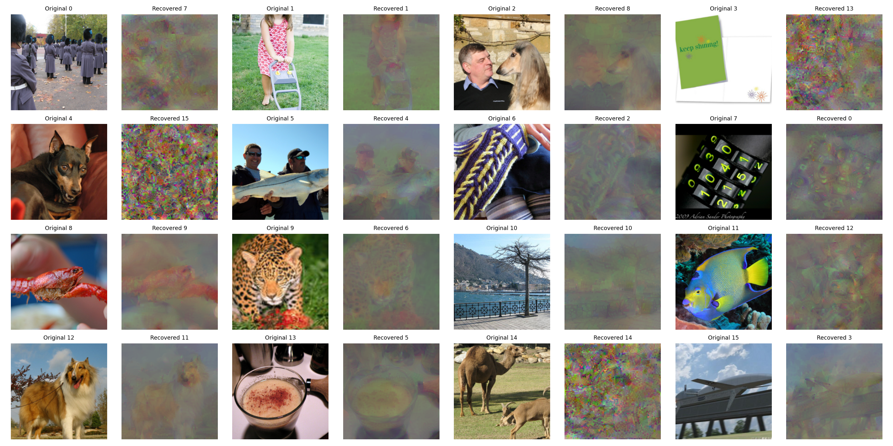

# CPA_SINGLE_CLIENT_FP32_INT8_FAST4000_GD4000_FIA25000_20261006_INT8

Status: COMPLETED.

Single-client B16/T10 signed symmetric deterministic per-tensor INT8; frozen VGG16 Conv, trained FC; seed42.

FastICA exactly4000 (early stop disabled), GD-ICA exactly4000, Direct FIA exactly25000. No generator, cell optimization, new observation, candidate selection or private feedback.

PSNR: 12.054908 dB; SSIM: 0.295547; VGG LPIPS: 0.562428; MSE: 0.07020477.

Separation: 45.81s; FIA: 2053.88s.

All16 images evaluated. Pixel-MSE Hungarian matching is computed once and shared by every metric. Only x is consumed from the deserialized evaluation bundle; bundled keys are disclosed in metrics.json. No quantitative success threshold was supplied; software completion alone is not proof of successful reconstruction. No actual-update cell feasibility claim.

Attack wall time: 2100.293s; peak CUDA allocated: 3.286GiB. Same archived single-client update as the existing INT4 arm.
